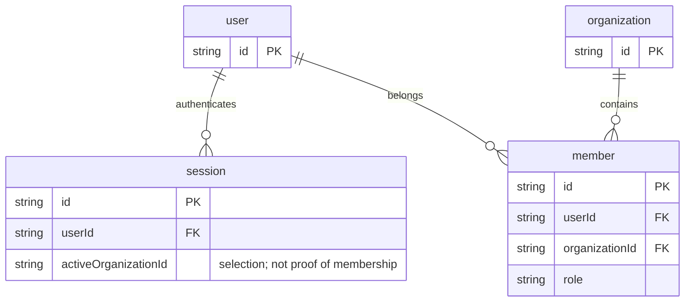
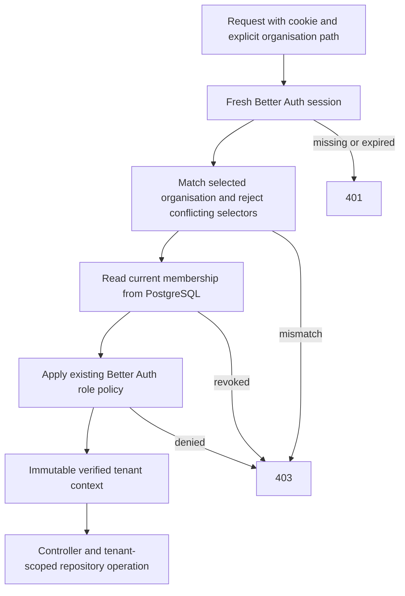

# Organisation API access — R10 / Gather #7636

## Scope and dependency

Builds on the Better Auth organisation plugin and membership tables from PR #9
(`feat/organizations`). This is the API access prerequisite for prospect CRUD
(R15) and the prospect UI (R18). It does **not** implement prospect persistence,
custom fields, or a new CRM permission matrix.

**No DB changes. No migrations.** Existing auth table names are retained for
compatibility; this PR does not rename them to the Rails convention for new tables.

## API contract

`GET /api/organizations/:organizationId/access`

Requires a valid Better Auth session cookie and an active organisation matching
`:organizationId`. The current database membership must still exist.

Returns exactly `{ organizationId, userId, role }`. No session/token is returned.
Missing, revoked, forged or expired sessions receive 401. Missing membership,
unselected/conflicting organisations, unsupported roles, missing route policy,
or insufficient permissions receive 403. There is no fallback to a first or
previous organisation. Switch using the existing
`POST /auth/organization/set-active` before requesting another organisation.

The path is the tenant selector. If `x-organization-id`, query `organizationId`,
or body `organizationId` are also supplied they must equal the path, including
type (arrays and null are rejected). Never use a payload tenant/owner/assignee
field as authority for a database operation.

## Controller/repository contract

- Every non-public Nest API requires `@RequireOrganization(...)` and an explicit
  `:organizationId` route parameter. The global guard fails closed if either is
  missing. The existing health route remains explicitly `@AllowAnonymous()`.
- `@CurrentOrganization()` injects an immutable, server-verified context. Use its
  `organizationId` to scope every repository read/write and foreign-key lookup.
  A guard alone does not make an unscoped repository query safe.
- The guard resolves a fresh session with cookie-cache bypass and reads membership
  on every request. Role/membership changes affect the next request; an already
  authorised in-flight operation is not cancelled retroactively.
- Unsafe HTTP methods also enforce Better Auth's existing trusted-origin policy.
  Untrusted/null origins and browser cross-site writes without an Origin fail;
  non-browser clients without Origin remain supported. No new origin allowlist.
- `@RequireOrganization()` allows membership-only access. Action permissions use
  Better Auth's existing `defaultRoles`: owner/admin/member, including combinations
  of these roles. Unknown/custom roles fail closed until explicitly supported.
- Example management permission: `@RequireOrganization({ organization: ['update'] })`
  allows owner/admin, not member. Ownership is a membership role, not assignment.
- Better Auth continues to own `/auth/*` and its management endpoints. No duplicate
  organisation CRUD endpoint is added. Future user-only Nest APIs need a deliberate
  separate policy rather than weakening this tenant boundary.
- Domain-specific permissions, payload validation and relationship scoping belong
  to the relevant API tickets; they must not be inferred from the three-field UI preview.

## Existing database relationships (unchanged)



## New request flow



## Verification

The integration suite starts a real Nest HTTP listener, signs up/signs in through
Better Auth, and uses real PostgreSQL memberships and sessions. A test-only
controller proves a tenant-scoped write persists/reloads, denied writes leave
records untouched, and role demotion/revocation takes effect on the next request.
It is not registered in the production module. Test fixtures use random IDs and
cleanup deletes only those fixture organisations/users.

Use an **isolated test database** whose name ends in `_test`. The suite refuses to
run without `TEST_DATABASE_URL`; it neither reads the application `.env` nor resets
an existing database. Provision the database yourself, then from the repository root:

```sh
export TEST_DATABASE_URL='postgresql://TEST_USER@127.0.0.1:TEST_PORT/zuko_access_test'
export DATABASE_URL="$TEST_DATABASE_URL"
pnpm exec prisma generate --config apps/backend/prisma.config.ts
pnpm exec prisma migrate deploy --config apps/backend/prisma.config.ts
pnpm exec vitest run --config apps/backend/vitest.integration.config.mts
pnpm exec vitest run --config apps/backend/vitest.config.mts
pnpm exec nx build @zuko/backend
```

The migration command applies existing base migrations to the isolated test
DB only. It is not authorisation for any application/production migration.
